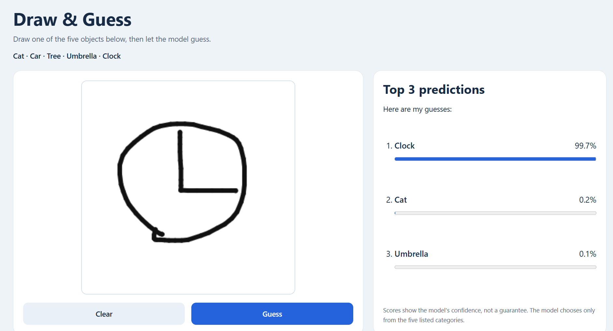

# Interactive Drawing Recognition App

**Draw & Guess** is a local web app that recognizes five hand-drawn objects: **cat, car, tree, umbrella, and clock**. Draw on the canvas and click **Guess** to see the top three predictions and their confidence scores.

The project uses a PyTorch convolutional neural network (CNN), a Flask server, and an HTML/JavaScript drawing interface. Development was carried out in PyCharm.



## Features

- Draw with a mouse or touch input, then clear the canvas for another attempt.
- View three ranked predictions with confidence percentages and bars.
- Run the included trained model locally on CPU.

Scores are softmax model scores across all five categories. They are not guaranteed probabilities of being correct. Only the top three scores are displayed, so they may add up to less than 100%.

## Run the app

Use **Python 3.12**, [uv](https://docs.astral.sh/uv/getting-started/installation/), and Git. The recorded development environment was Windows with Python 3.12.14. Dependencies are recorded in `pyproject.toml` and `uv.lock`.

Get a copy of the project:

```powershell
git clone https://github.com/GoobinJung/drawing-recognition-app.git
cd drawing-recognition-app
```

Open the project folder in PyCharm. From its project terminal, run:

```powershell
uv sync --locked --python 3.12
uv run --locked python app.py
```

Open [http://127.0.0.1:5000](http://127.0.0.1:5000) in a browser. Keep the server running while using the app. Stop it with the PyCharm Stop button or Ctrl+C.

The quick start uses the included checkpoint at `models/drawing_cnn.pt`. In PyCharm, the app can also be run by selecting the project `.venv` interpreter and running `app.py`.

## Data and training

The project uses the 28×28 grayscale NumPy bitmaps from Google's Quick, Draw! dataset. The preparation script randomly selects **2,000 nonblank, unique images per category**, using seed **42**. Exact duplicate pixel images are excluded across the selected set before splitting.

| Split | Images per category | Total images |
| --- | ---: | ---: |
| Training | 1,400 | 7,000 |
| Validation | 300 | 1,500 |
| Test | 300 | 1,500 |

The CNN has two convolution blocks with 16 and 32 channels, each followed by ReLU and max pooling. A 64-unit hidden layer leads to five output scores.

Training uses Adam, a learning rate of 0.001, batch size 64, and cross-entropy loss for 10 epochs on CPU. The checkpoint with the highest validation accuracy is saved. The recorded run selected **epoch 6**, with **95.07% validation accuracy**.

The browser drawing is converted to grayscale, inverted to white lines on black, cropped, resized with its proportions preserved, and centered in a 28×28 image. Pixel values are scaled to 0–1 before prediction.

### Recreate the training workflow

Use a separate clone to preserve the recorded model and results: training replaces the checkpoint and training history.

```powershell
uv run --locked python download_data.py
uv run --locked python prepare_data.py
uv run --locked python preview_data.py
uv run --locked python train.py
uv run --locked python evaluate.py
```

The downloader retrieves the complete files for the five categories; only the selected subset is used for training and evaluation. Downloaded and prepared data are stored under `data/`, which is excluded from Git. Retraining results may vary across environments.

## Recorded results

| Evaluation | Images | Top-1 accuracy | Top-3 accuracy |
| --- | ---: | ---: | ---: |
| Held-out Quick, Draw! test | 1,500 | **95.13%** (1,427 correct) | **99.47%** |
| Manual app drawing sample | 25 | **100%** (25 correct) | **100%** |

Top-1 accuracy measures whether the first prediction is correct. Top-3 accuracy measures whether the correct category appears among the three predictions.

In the held-out test, the most common error was **cat predicted as car: 16 cases**. The manual sample contains five drawings per category, with screenshots of all 25 results. Cars had the lowest mean displayed top-1 confidence, **58.90%**, while clocks had the highest, **97.20%**.

The manual sample is small and several drawings have similar styles. Its 100% result does not establish 100% accuracy for other users or drawings. These two evaluations use different samples and should be reported separately.

- [Training history](results/training_history.json)
- [Held-out test metrics and incorrect predictions](results/test_metrics.json)
- [Manual drawing results](results/manual_drawing_results.json)
- [Manual evaluation summary](results/manual_drawing_evaluation.md)
- [All 25 manual evaluation screenshots](results/manual_drawings)

## Main files

| File | Purpose |
| --- | --- |
| `app.py` | Flask routes, drawing preprocessing, and predictions |
| `templates/index.html` | Drawing canvas, buttons, results, and interface styling |
| `model.py` | CNN architecture |
| `download_data.py` | Download the five dataset files |
| `prepare_data.py` | Select images and create data splits |
| `preview_data.py` | Show examples of training images |
| `train.py` | Train the model and save the best checkpoint |
| `evaluate.py` | Evaluate the saved model on the held-out test set |
| `check_environment.py` | Check the required libraries |
| `models/drawing_cnn.pt` | Saved trained model and class names |

## Limitations

The app always chooses from five categories; it has no separate category for unsupported objects. Model scores have not been calibrated. More varied drawings from different users would provide a stronger manual evaluation.

This is a local course-project app using Flask's development server. A future version could improve handling of different drawing styles and test more varied inputs.

## Dataset credit

This project uses [The Quick, Draw! Dataset](https://github.com/googlecreativelab/quickdraw-dataset), made available by Google, Inc. under [Creative Commons Attribution 4.0 International](https://creativecommons.org/licenses/by/4.0/).

This project selects five categories, filters blank and exact duplicate images from the selected set, creates custom splits, reshapes the supplied bitmaps, and scales pixel values for model input.
